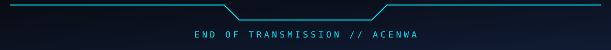

<div align="center">


### `SOFTWARE ENGINEERING` · `IT INFRASTRUCTURE` · `WEB3` · `AUTOMATION`

Building practical digital systems, immersive applications, and resilient infrastructure.

[](https://ronin-exe.us/about)
[](https://audiocartel.net)
[](https://github.com/acenwa)

</div>

---

## `> WHOAMI`

```text
IDENTITY     Alozie C. Nwachukwu // DIGITAL SYSTEMS ARCHITECT
FOCUS        Python • Django • Linux • Automation • Web3
OPERATIONS   Application Engineering • Systems Administration • Integrations
MISSION      Build reliable technology with a distinctive digital experience.
STATUS       [ ONLINE ]
```

## `> TECH STACK`

<div align="center">


</div>

## `> ACTIVE SYSTEMS`

<table>
<tr>
<td width="50%" valign="top">


### AUDIO CARTEL
A music, creator-services, and Web3 ecosystem with Django infrastructure, identity verification, activity tracking, and blockchain settlement.

**Stack:** Django · PostgreSQL · Celery · Polygon

[Explore platform ↗](https://audiocartel.net)
</td>
<td width="50%" valign="top">


### RONIN.EXE
IT support and digital services, combining customer workflows, automation, secure payments, and production infrastructure.

**Stack:** Django · Linux · Nginx · Stripe

[Explore services ↗](https://ronin-exe.us)
</td>
</tr>
<tr>
<td colspan="2" valign="top">


### FLEXII WORLD
An in-development galactic trading environment, representing trading systems as spaceships and market sectors as explorable planets.

**Exploring:** Python · Brokerage APIs · Data pipelines · 3D interfaces
</td>
</tr>
</table>

## `> SYSTEM PRINCIPLES`

```text
[01] BUILD      Useful, maintainable applications.
[02] SECURE     Protect systems, identities, and transactions.
[03] AUTOMATE   Remove repetitive work with dependable workflows.
[04] EVOLVE     Test, measure, and improve continuously.
```

<div align="center">



</div>
