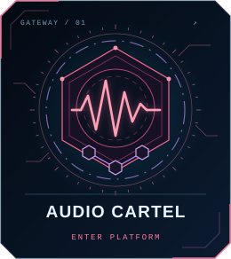
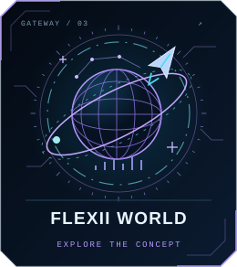
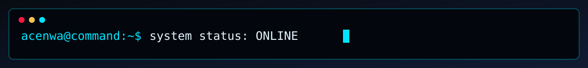

  

<h1 align="center">Alozie C. Nwachukwu</h1>

  <strong>Software Engineering · IT Infrastructure · Automation · Web3</strong> 
  Building practical digital systems, immersive applications, and resilient infrastructure.

  
  
  

## `00 // PLATFORMS`

<h3 align="center">Audio Cartel</h3>

  

<code>MUSIC</code> &nbsp; <code>CREATOR SERVICES</code> &nbsp; <code>WEB3</code>

A music and creator-services ecosystem with Django infrastructure, identity verification, activity tracking, and blockchain settlement.

<code>Django</code> · <code>PostgreSQL</code> · <code>Celery</code> · <code>Polygon</code>

  

<h3 align="center">RONIN.EXE</h3>

  

<code>IT SUPPORT</code> &nbsp; <code>DIGITAL SERVICES</code> &nbsp; <code>INFRASTRUCTURE</code>

Customer workflows, automation, secure payments, and production infrastructure brought together in a digital-services platform.

<code>Django</code> · <code>Linux</code> · <code>Nginx</code> · <code>Stripe</code>

  
  

<h3 align="center">Flexii World</h3>

  

<code>GALACTIC INTERFACES</code> &nbsp; <code>TRADING SYSTEMS</code>

An exploration of trading systems as spaceships and market sectors as planets, bringing financial data into an immersive galactic interface.

<code>Python</code> · <code>Brokerage APIs</code> · <code>Data pipelines</code> · <code>3D interfaces</code>

## `01 // ENGINEERING TOOLKIT`

- **`APPLICATIONS`** — Python · Django · JavaScript
- **`DATA & BACKGROUND WORK`** — PostgreSQL · Redis · Celery
- **`INFRASTRUCTURE`** — Linux · Docker · Nginx · Git
- **`INTEGRATIONS`** — Polygon · Stripe · Brokerage APIs

## `02 // BUILD PROTOCOL`

- **`BUILD`** useful, maintainable applications.
- **`SECURE`** systems, identities, and transactions.
- **`AUTOMATE`** repetitive work with dependable workflows.
- **`EVOLVE`** through testing, measurement, and continuous improvement.

  
  
  

  

